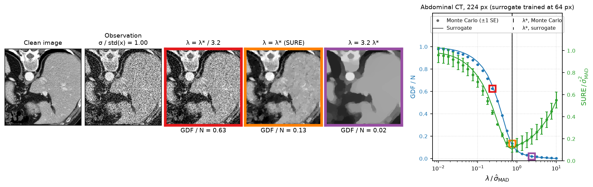

# gdfnet-tvdenoise

Neural estimation of the generalized degrees of freedom (GDF) for isotropic 2D
Total Variation (TV) denoising. Given a noisy image and a TV regularization
strength, the package predicts the normalized GDF and evaluates SURE and the
Morozov discrepancy criterion.



*Left: an abdominal CT image (224 × 224 px), its noisy observation, and TV
reconstructions below, at, and above the SURE-selected λ\*, with their GDF per pixel.
Right: GDF and SURE along λ from Monte Carlo (points, 1 SE) and from the surrogate
(lines), which was trained on 64 px images. Both select the same λ\*. Rendered by
`plot_overview()`.*

## Scope

Isotropic 2D TV denoising. Modalities are LiTS abdominal CT, ChestMNIST,
PathMNIST, and BloodMNIST. Training images are 64 px; test images are 64, 128,
and 224 px. The solver is Chambolle-Pock with a calibrated fixed budget: each
label runs K(L, η) iterations, where K is linear in log η between per-size tier values.
The tier values are the largest K at which the solver and finite-difference errors stay
within 0.3 of the Monte Carlo standard error on hand-picked calibration images.

## Install

The code is tested with Python 3.11.

```bash
pip install -r requirements.txt
```

Data download and generation also need `pip install -r requirements-data.txt`.

## Quick start

```python
import torch
from gdfnet_tvdenoise import predict_gdf

y = torch.rand(64, 64)  # replace with your observed image
r = predict_gdf(y, 0.05)
print(r.shape, float(r))
```

`predict_gdf` loads the default checkpoint (`models/model_003`), runs the
surrogate, and returns the normalized GDF `r = GDF / n_pixels` as a CPU tensor of
shape `[1]`. `n_pixels = H * W`, so the nominal range of `r` is `[0, 1]`. Reports and
datasets also call `r` the capacity and store it as `gdf_n`. Monte Carlo labels are
stored unclamped, so a label can fall outside `[0, 1]`; training clamps the targets.
See [docs/REFERENCE.md](docs/REFERENCE.md)
for accepted shapes and for explicit model loading and feature extraction.

The same prediction from the command line:

```bash
python -m gdfnet_tvdenoise infer --lambda-tv 0.05 --image y.npy
```

`--image` accepts a `.npy` or `.pt` file. Without `--image`, the command uses a fixed
random 64 × 64 image.

To rerun the benchmarks of the published model on the tracked test sets:

```bash
python -m gdfnet_tvdenoise benchmark --model-path models/model_003
```

This rewrites the reports and plots in `models/model_003/`.

## Configuration

`gdfnet_tvdenoise/config.py` holds all constants, paths, defaults, and workloads.
Every module imports from it, and the CLI reads its defaults from it. There are no
config files and no environment variables. To change a setting, edit `config.py`.

Common edits:

- Force a device: set `DEFAULT_DEVICE`, for example to `torch.device("cpu")`. The
  default is the current PyTorch accelerator, else CPU.
- Select the datasets that `train` and the benchmarks read: edit `DEFAULT_DATASETS`.
- Define a workload: edit a `DEFAULT_*_WORKLOAD` dict, or pass a new dict to
  `generate_stochastic` or `generate_sweeps` from Python. The CLI accepts only the
  names of the default workloads.

Some constants are bound to the bundled models, datasets, and calibration. A change
to them makes the bundled files inconsistent with the code.
[docs/REFERENCE.md](docs/REFERENCE.md#configuration-configpy) lists the constants
that are safe to change and the artifacts that each bound constant requires.

## Pipeline

The full pipeline reproduces the published models and reports. Steps 1 to 7 rebuild
the bundled data and calibration. They are optional: the bundled files cover them, so
you can start at step 8. Run the commands from the repository root in a Python 3.11
environment:

```bash
python3.11 -m venv .venv
source .venv/bin/activate
pip install -r requirements-data.txt  # includes requirements.txt
```

### Steps 1 to 7 (optional): rebuild the bundled data

```bash
# 1. Fetch sources: data/archives/ (MedMNIST+), data/lits_raw/
python -m gdfnet_tvdenoise generate --source all
# 2. Build the LiTS archives: data/archives/lits_{size}.npz
python -m gdfnet_tvdenoise generate --prepare-lits
# 3. Tabulate the flat-region solver error: data/calibration/e_k_table.pt
python -m gdfnet_tvdenoise calibrate --which table
# 4. Calibrate the solver budget K: data/calibration/k_calibration.pt
python -m gdfnet_tvdenoise calibrate --which k
# 5. Manual: copy the printed SOLVER_K_TIERS into config.py
# 6. Generate the datasets: data/generated/{name}_00N.pt, data/generated/test/{name}_00N.pt
python -m gdfnet_tvdenoise generate --stochastic all
python -m gdfnet_tvdenoise generate --sweeps all
# 7. Manual: point every DEFAULT_DATASETS entry in config.py at the new files
```

- Steps 1 and 2 need `requirements-data.txt`. Steps 4 and 6 read the archives from
  steps 1 and 2. Step 2 checks the LiTS slices against `data/lits_split.pt` and rewrites the
  tracked `data/lits_archive_manifest.pt`.
- Steps 3 and 4 overwrite the bundled calibration files.
- Step 4 runs a float32 solve on the default device and a float64 reference on the
  CPU in lockstep. It takes about 6.5 h and resumes after an interruption. It prints
  the `SOLVER_K_TIERS` block and says if it differs from `config.py`. See
  [K calibration](docs/REFERENCE.md#k-calibration).
- Step 6 runs every stochastic workload (`training`, `parity`, `scale_parity`,
  `val_parity`) and every sweeps workload (`sweeps`, `scale_sweeps`). The sample draws
  (modality, image, NSR, λ) are unseeded, so every run draws a new dataset.
- Step 6 writes new files and never overwrites the bundled `.pt.xz` files. Step 7
  makes `train` and the benchmarks read the new files.

### Steps 8 to 11: train, select, and benchmark

```bash
# 8. Train three seeds: each run writes the next free models/model_00N/weights.pt
python -m gdfnet_tvdenoise train --seed 11
python -m gdfnet_tvdenoise train --seed 29
python -m gdfnet_tvdenoise train --seed 47
# 9. Validation parity for each new model: models/model_00N/val_parity.pt
python -m gdfnet_tvdenoise benchmark --model-path models/model_00N --suite val_parity
# 10. Read the validation MAE of each model
python -c "from gdfnet_tvdenoise.helpers import load_pt; \
print(load_pt('models/model_00N/val_parity.pt')['summary_metrics']['mae_pct'])"
# 11. All suites for the median model: reports and plots in models/model_00N/
python -m gdfnet_tvdenoise benchmark --model-path models/model_00N
```

- Replace `model_00N` with the directories that step 8 prints. With the bundled
  models present, they are `model_004` to `model_006`.
- Step 10 selects the model with the median validation MAE of the three, not the best.
- A rerun reproduces the conclusions, not the bundled files bit for bit. The sample
  draws, the observation noise, the Monte Carlo probes, and the calibration noise are
  unseeded by design. The training seeds 11, 29, and 47 are fixed, but training on an
  accelerator is not bit-reproducible.

## Bundled files

The repository ships the trained models, the datasets they were trained and tested
on, and the solver calibration. Schemas are in
[docs/REPORT_SCHEMA.md](docs/REPORT_SCHEMA.md). Differences between the bundled files
and a rerun of the current code are listed in
[docs/REFERENCE.md](docs/REFERENCE.md#bundled-artifact-provenance).

### Models

Three models with the same architecture, data, and hyperparameters. Only the
training seed differs. `model_003` is the median of the three by validation MAE
and is the default model. `config.PUBLISHED_MODELS` lists the three directories, and
`config.DEFAULT_MODEL` names the default.

| Directory | Seed | Files |
|---|---|---|
| `models/model_001/` | 11 | `weights.pt`, `val_parity.pt` |
| `models/model_002/` | 29 | `weights.pt`, `val_parity.pt` |
| `models/model_003/` | 47 | `weights.pt`; reports `parity.pt`, `val_parity.pt`, `sweeps.pt`, `scale_parity.pt`, `scale_sweeps.pt`; plots `parity.png`, `sweeps.png`, `scale_parity.png`, `scale_sweeps.png` |

### Datasets

| File | Content |
|---|---|
| `data/generated/training_001.pt.xz` | Training data: 4,000 train and 700 validation samples, 64 px |
| `data/generated/test/parity_001.pt.xz` | Test parity: 100 samples, 64 px, test split |
| `data/generated/test/val_parity_001.pt.xz` | Validation parity for model selection: 200 samples, 64 px, validation split |
| `data/generated/test/scale_parity_001.pt.xz` | Resolution transfer parity: 200 samples (100 each at 128 and 224 px), test split |
| `data/generated/test/sweeps_001.pt.xz` | Regularization sweeps: 12 regimes × 25 λ values, 64 px |
| `data/generated/test/scale_sweeps_001.pt.xz` | Resolution transfer sweeps: 24 regimes × 25 λ values, 128 and 224 px |
| `data/lits_split.pt` | Authoritative LiTS patient split and slice order for `prepare_archives` |
| `data/lits_archive_manifest.pt` | LiTS volumes and slices per split and size, with the inputs that determine them |

Each benchmark suite reads the dataset of the same name by default; `scale_parity`
reads both `parity` and `scale_parity`. The default files are listed in
`config.DEFAULT_DATASETS`.

Running a generator writes a new plain `.pt` file next to the bundled `.pt.xz`
files, for example `data/generated/test/parity_002.pt`. Bundled files use `.pt.xz`;
generated files use `.pt` and are never overwritten.

An interrupted generator run leaves a `{name}_00N.pt.partial` file. Rerunning the
same command resumes it; `--fresh` discards the partial and starts over.

### Calibration

| File | Content |
|---|---|
| `data/calibration/e_k_table.pt` | Precomputed flat-region solver error e(K, L) up to the stored `k_max` at 64/128/224 px |
| `data/calibration/k_calibration.pt` | Calibrated K* per configuration: 72 images × 3 noise levels, and the tier values per size |

The solver reads the tier values from `SOLVER_K_TIERS` in `config.py`, not from
`k_calibration.pt`. See [Configuration](#configuration) and
[Pipeline](#pipeline).

Source image archives are not bundled. `fetch_data` and `prepare_archives`
rebuild them (see [docs/REFERENCE.md](docs/REFERENCE.md#data)). Data licenses are in
[DATA_LICENSE.md](DATA_LICENSE.md).

## Repository layout

```text
gdfnet_tvdenoise/     package: inference, features, model, solver, data, calibration, training
  benchmarks/         benchmark suites and plots
  config.py           all constants, paths, defaults, and workloads
data/
  calibration/        solver calibration artifacts
  generated/          training dataset; test/ holds the benchmark datasets
  lits_split.pt       LiTS patient split and slice order
  lits_archive_manifest.pt  LiTS archive counts per split and size, with their inputs
  archives/           source image archives (not bundled; written by step 1 and 2)
  lits_raw/           raw LiTS volumes (not bundled; written by step 1)
models/               model_001 to model_003: weights, reports, and plots
docs/                 function reference and artifact schemas
scratch/              temporary files and logs (ignored by git)
```

## Documentation

- [docs/REFERENCE.md](docs/REFERENCE.md): configuration, function reference, command
  line, artifact provenance, and exceptions.
- [docs/REPORT_SCHEMA.md](docs/REPORT_SCHEMA.md): checkpoint, data, report, and
  calibration schemas.
- [DATA_LICENSE.md](DATA_LICENSE.md): data sources, licenses, and modifications.

## Citation

Cite the software with the metadata in [CITATION.cff](CITATION.cff) (version 0.4.0).
Also cite the data sources listed in [DATA_LICENSE.md](DATA_LICENSE.md).

## Licenses

Code and model weights are MIT licensed. Data artifacts are CC BY-SA 4.0. See
`DATA_LICENSE.md` for source attribution and the modification record.
